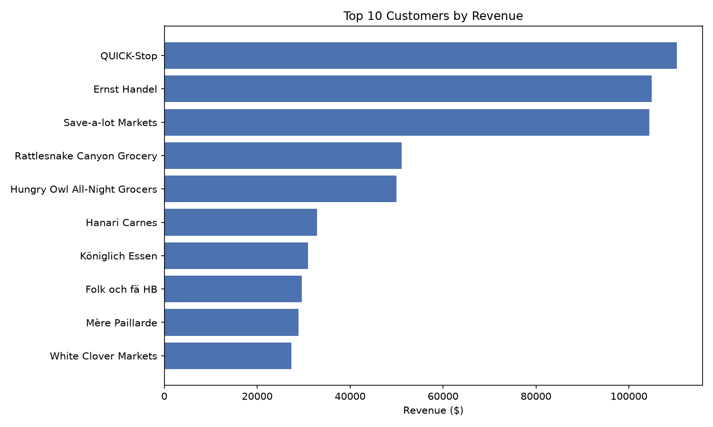
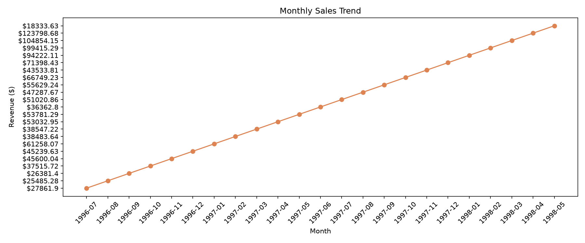
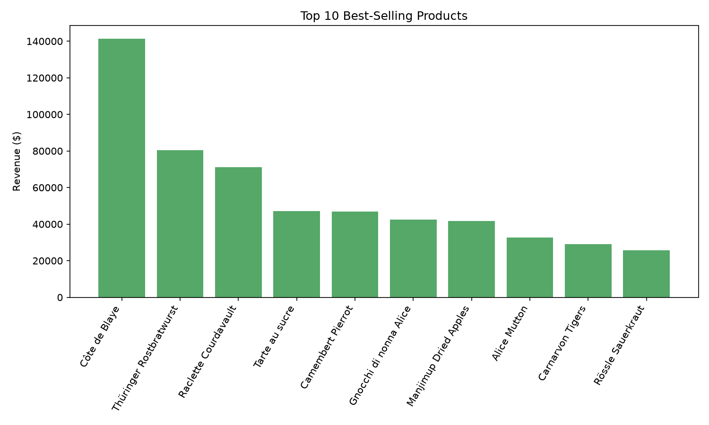

# Northwind Sales Analysis with SQL & Python


Answering real business questions about a trading company's sales using multi-table SQL queries, then visualizing the results with Python.

**Tools:** SQL (SQLite), Python, pandas, matplotlib

---

## The Problem

The Northwind database holds a trading company's customers, orders, products, employees and shippers across 8 tables. The business needs to know who its best customers are, how sales trend over time, which products sell best, and how well staff and shippers perform.

## Dataset

[Northwind 2000 SQLite database (Kaggle)](https://www.kaggle.com/datasets/munawarsaudagar/northwind-2000-sqlite-database-simplified), tables: `Categories`, `Customers`, `Employees`, `OrderDetails`, `Orders`, `Products`, `Shippers`, `Suppliers`.

Revenue in every query is calculated as `UnitPrice x Quantity x (1 - Discount)`.

## Queries and Findings

Each query has its own `.sql` file and a matching Python script that runs it. Queries 1-3 also have a separate `_chart.py` script that builds the chart.

### 1. Top 10 customers by revenue
`q1_top_customers.sql` joins `Customers`, `Orders` and `OrderDetails`.
[ADD one sentence, e.g. who the top customer is and how much they spent.]



### 2. Monthly sales trend
`q2_monthly_sales.sql` joins `Orders` and `OrderDetails` and groups by month.
[ADD one sentence on the trend, e.g. growth over time or a peak month.]



### 3. Best-selling products by category
`q3_best_products.sql` joins `Products`, `Categories` and `OrderDetails`.
[ADD one sentence, e.g. the top product and which category leads.]



### 4. Employee sales performance
`q4_employee_sales.sql` joins `Employees`, `Orders` and `OrderDetails` to rank employees by revenue and orders handled.
[ADD one sentence, e.g. the top employee. Results are shown as a table because there are only a handful of employees.]

### 5. Shipper usage and delivery time
`q5_shipper_performance.sql` joins `Orders` and `Shippers` to compare orders shipped and average delivery days.
[ADD one sentence, e.g. which shipper is fastest. Results are shown as a table because there are only three shippers.]

## Example Query

```sql
SELECT c.CompanyName,
       ROUND(SUM(od.UnitPrice * od.Quantity * (1 - od.Discount)), 2) AS Revenue
FROM Customers c
JOIN Orders o ON c.CustomerID = o.CustomerID
JOIN OrderDetails od ON o.OrderID = od.OrderID
GROUP BY c.CompanyName
ORDER BY Revenue DESC
LIMIT 10;
```

## Project Structure

```
sql-pipeline/
├── README.md
├── requirements.txt
├── northwind.sqlite                  # source database
├── q1_top_customers.sql
├── q1_top_customers.py
├── q1_top_customers_chart.py
├── q1_top_customers.png
├── q2_monthly_sales.sql
├── q2_monthly_sales.py
├── q2_monthly_sales_chart.py
├── q2_monthly_sales.png
├── q3_best_products.sql
├── q3_best_products.py
├── q3_best_products_chart.py
├── q3_best_products.png
├── q4_employee_sales.sql
├── q4_employee_sales.py
├── q5_shipper_performance.sql
└── q5_shipper_performance.py
```

## How to Run

```bash
pip install -r requirements.txt

# print the result table for a query
python q1_top_customers.py

# build the chart (queries 1-3)
python q1_top_customers_chart.py
```

Every script finds `northwind.sqlite` relative to its own location, so you can run it from any folder.

## Skills Demonstrated

Multi-table SQL JOINs, aggregation and grouping, date functions, calculated metrics, running SQL from Python, data visualization, organizing a reusable analysis project.
