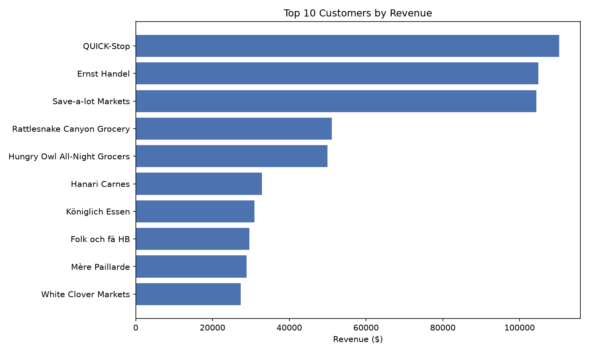
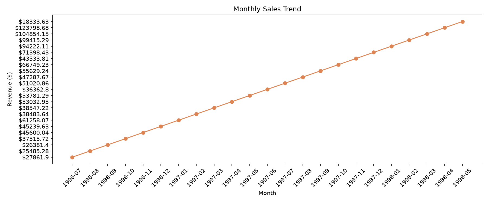
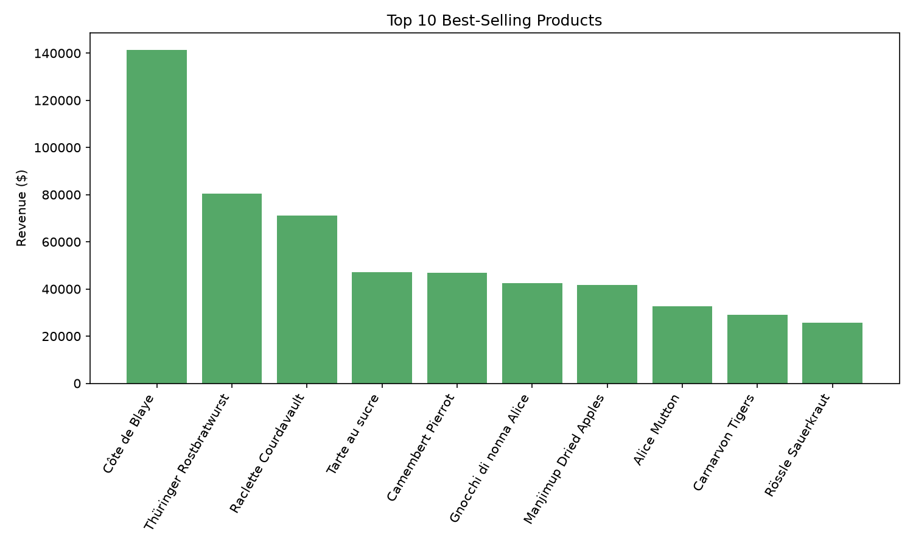

# Northwind Sales Analytics — SQL → Python Pipeline


A end-to-end SQL analysis of the Northwind trading database, answered with five
business questions and delivered as clean SQL, reproducible Python scripts, and
presentation-ready charts.

The goal is simple: **turn raw transactional tables into decisions** — who the
most valuable customers are, where revenue is growing, which products deserve
stock priority, how the sales team is performing, and which shipper gives the
best service.

---

## Key findings

| Metric | Result |
|---|---|
| Total revenue analysed | **$1,265,793** across **830 orders** |
| Average order value | **$1,525** |
| Top customer | **QUICK-Stop — $110,277** (8.7% of revenue) |
| Top 3 customers combined | **25.2%** of revenue |
| Top product | **Côte de Blaye — $141,397** (11.2% of revenue) |
| Top category | **Beverages — $267,868** (21.2% of revenue) |
| Growth, H2 1997 vs H2 1996 | **+61.3%** |
| Growth, Jan–Apr 1998 vs Jan–Apr 1997 | **+120.7%** |
| Orders shipped by the required date | **95.4%** |
| Average order-to-ship time | **8.5 days** |

**What the numbers say**

- Revenue nearly doubled year over year in the comparable January–April window,
  and the monthly trend is consistently upward from mid-1996 through April 1998.
- The business is not dangerously dependent on a single account: the largest
  customer is under 9% of revenue, and 88 of 89 buying customers placed repeat
  orders.
- A small group of products carries a large share of sales. Côte de Blaye alone
  generates more than the next two products combined — a stockout here would be
  expensive.
- Volume and speed do not line up for shippers: Federal Shipping is the fastest
  (7.5 days average) but handles the fewest orders, while United Package carries
  the most volume at a slower 9.2 days.

---

## Visualisations

### Top 10 customers by revenue



QUICK-Stop, Ernst Handel and Save-a-lot Markets form a clear top tier, each above
$104K. There is then a steep drop to the $50K band, which makes the top three the
obvious targets for retention and account management.

### Monthly sales trend



Revenue grows from roughly $27K/month in July 1996 to $124K in April 1998.
The trend is not perfectly smooth — seasonal dips appear in February, June and
November — but every peak is higher than the last.

### Top 10 products by revenue



Beverages and dairy dominate the top of the list. Note that units sold and
revenue tell different stories: Raclette Courdavault sells 1,496 units but earns
less than Côte de Blaye at 623 units, so ranking by quantity alone would
misallocate stock.

### Sales performance by employee

| Employee | Revenue | Orders handled |
|---|---:|---:|
| Margaret Peacock | $232,890.85 | 156 |
| Janet Leverling | $202,812.84 | 127 |
| Nancy Davolio | $192,107.60 | 123 |
| Andrew Fuller | $166,537.76 | 96 |
| Laura Callahan | $126,862.28 | 104 |
| Robert King | $124,568.24 | 72 |
| Anne Dodsworth | $77,308.07 | 43 |
| Michael Suyama | $73,913.13 | 67 |
| Steven Buchanan | $68,792.28 | 42 |

Margaret Peacock leads on both revenue and order volume. Robert King earns more
per order than Laura Callahan despite handling fewer orders, which points to a
different mix of deal sizes rather than a performance gap.

### Shipper performance

| Shipper | Orders shipped | Avg. delivery days |
|---|---:|---:|
| United Package | 315 | 9.2 |
| Federal Shipping | 249 | 7.5 |
| Speedy Express | 245 | 8.6 |

Federal Shipping is the fastest option, but it is also the least used. There is
a real trade-off between capacity and speed worth revisiting in contract terms.

---

## Business questions answered

| # | Question | SQL | Python |
|---|---|---|---|
| 1 | Who are the top 10 customers by revenue? | [`q1_top_customers.sql`](q1_top_customers.sql) | [`q1_top_customers.py`](q1_top_customers.py) |
| 2 | How has monthly revenue moved over time? | [`q2_monthly_sales.sql`](q2_monthly_sales.sql) | [`q2_monthly_sales.py`](q2_monthly_sales.py) |
| 3 | Which products and categories sell best? | [`q3_best_products.sql`](q3_best_products.sql) | [`q3_best_products.py`](q3_best_products.py) |
| 4 | How does each employee perform? | [`q4_employee_sales.sql`](q4_employee_sales.sql) | [`q4_employee_sales.py`](q4_employee_sales.py) |
| 5 | Which shipper is fastest and busiest? | [`q5_shipper_performance.sql`](q5_shipper_performance.sql) | [`q5_shipper_performance.py`](q5_shipper_performance.py) |

Each question has a standalone `.sql` file, a `.py` runner that prints the result
as a Markdown table, and — for questions 1–3 — a `_chart.py` script that exports
a PNG.

---

## Dataset

The analysis runs on the **Northwind 2000** sample trading database, shipped as a
single SQLite file (`northwind.sqlite`) so the project is fully self-contained.

| Table | Rows | Description |
|---|---:|---|
| `Orders` | 830 | Order header: customer, employee, dates, shipper, freight |
| `OrderDetails` | 2,155 | Line items: product, unit price, quantity, discount |
| `Customers` | 91 | Company and contact details |
| `Products` | 77 | Product catalogue with category and pricing |
| `Categories` | 8 | Product categories |
| `Employees` | 9 | Sales staff |
| `Shippers` | 3 | Delivery partners |
| `Suppliers` | 29 | Product suppliers |

Coverage: **4 July 1996 – 6 May 1998**.

---

## Project structure

```
03-sql-pipeline/
├── northwind.sqlite              # Source database
├── input/                        # Original downloaded database
├── explore_schema.py             # Lists tables and row counts
├── q1_top_customers.sql          # Question 1: top customers
├── q1_top_customers.py           #   └ runner (Markdown output)
├── q1_top_customers_chart.py     #   └ chart export
├── q1_top_customers.png
├── q2_monthly_sales.sql          # Question 2: monthly trend
├── q2_monthly_sales.py
├── q2_monthly_sales_chart.py
├── q2_monthly_sales.png
├── q3_best_products.sql          # Question 3: product performance
├── q3_best_products.py
├── q3_best_products_chart.py
├── q3_best_products.png
├── q4_employee_sales.sql         # Question 4: employee performance
├── q4_employee_sales.py
├── q5_shipper_performance.sql    # Question 5: shipper performance
├── q5_shipper_performance.py
├── requirements.txt
└── README.md
```

---

## Running the project

```bash
# 1. Clone and enter the project
git clone <your-repo-url>
cd 03-sql-pipeline

# 2. Create an environment and install dependencies
python -m venv .venv
source .venv/bin/activate        # Windows: .venv\Scripts\activate
pip install -r requirements.txt

# 3. Print any result as a table
python q1_top_customers.py

# 4. Regenerate a chart (writes the PNG next to the script)
python q1_top_customers_chart.py
```

No database server is required — the scripts connect directly to the bundled
SQLite file using a path relative to the script, so they run from any working
directory.

---

## Technical approach

**SQL**

- Multi-table inner joins across `Customers → Orders → OrderDetails` and
  `Products → Categories`
- Revenue modelled as `UnitPrice × Quantity × (1 − Discount)`, using the price
  recorded on the order line rather than the current catalogue price
- Aggregation with `GROUP BY`, `ORDER BY` on the underlying numeric expression,
  and `LIMIT` for top-N rankings
- Date handling with `strftime('%Y-%m', …)` for monthly grouping and
  `julianday()` differences for delivery-time calculations
- `printf()` and string concatenation for consistent currency formatting
- `DISTINCT` counts where joins would otherwise inflate order counts

**Python**

- `sqlite3` for a zero-config connection to the database
- `pandas.read_sql_query()` to load each result set
- `to_markdown()` for readable, copy-pasteable output
- `matplotlib` for horizontal bar, line and vertical bar charts, with consistent
  colour palette and saved at 150 DPI

---

## Assumptions and data notes

- **Revenue** is net of line-item discount and excludes freight, tax and returns.
- **Discounts:** 38.9% of line items carry a discount; the average discounted
  line is 14.4% off. Revenue always reflects the discount actually applied.
- **Incomplete final month:** the data ends on 6 May 1998, so May 1998 covers only
  six days. It is included in the monthly table but excluded from the trend chart
  to avoid a misleading end-of-line drop.
- **Partial first year:** 1996 starts in July. Year-over-year comparisons therefore
  use like-for-like windows (H2 vs H2, Jan–Apr vs Jan–Apr) rather than raw annual
  totals.
- **21 orders** have no ship date (not yet shipped) and are excluded from delivery
  time calculations.
- The dataset is a sample, so absolute figures illustrate method and insight
  rather than a real company's performance.

---

## Skills demonstrated

`SQL` · `SQLite` · `Joins & aggregation` · `Date functions` · `Python` ·
`pandas` · `Matplotlib` · `Exploratory data analysis` · `Data storytelling` ·
`Reproducible reporting`

---

## About

I build clear, reproducible data analyses — from raw SQL through to charts and
written insights that non-technical stakeholders can act on.

- **Fiverr:** [@muhammad_abbe]
- **Upwork:** [https://www.upwork.com/freelancers/~0146279f64a593317a?mp_source=share]
- **Email:** [abdul_lord@hotmail.com]

Available for SQL reporting, dashboard work, data cleaning and ad-hoc analysis.

---

*Dataset: Microsoft Northwind sample database. Code released under the MIT License.*
